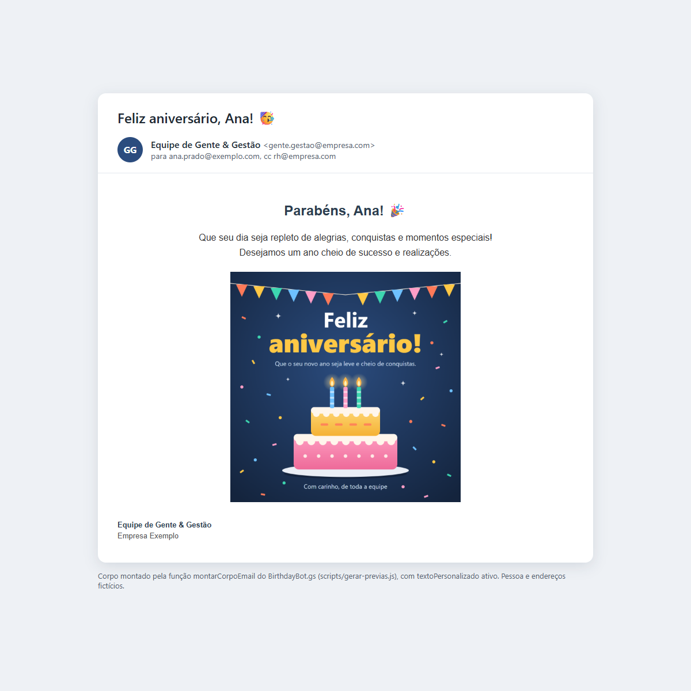
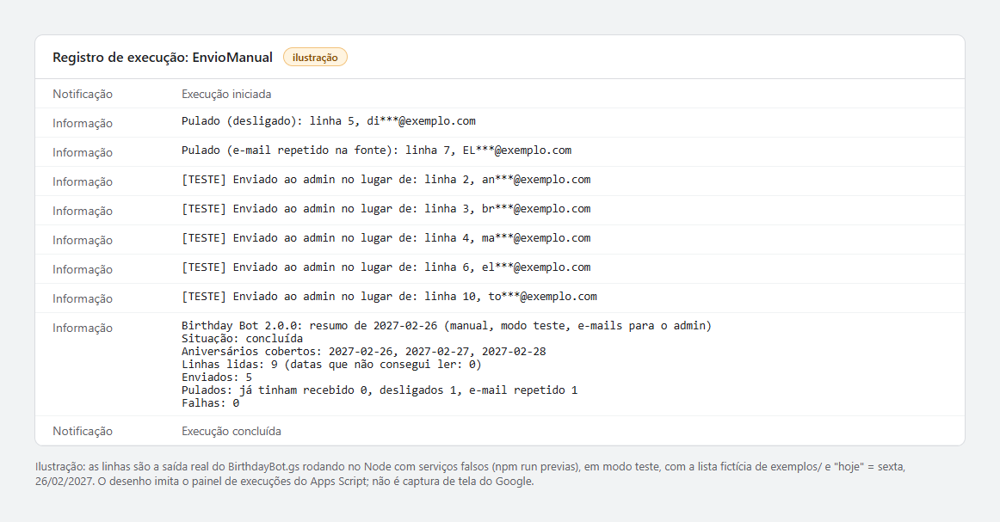
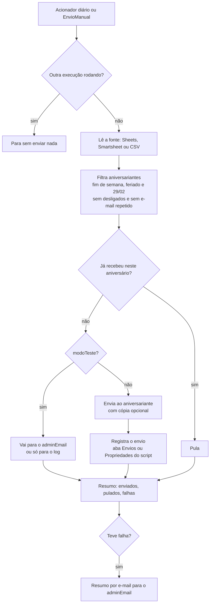

# 🎂 Birthday Bot v2: e-mail de aniversário automático para colaboradores


Um único arquivo de Google Apps Script que, todo dia, acha quem faz aniversário na sua lista de colaboradores e manda um e-mail com uma imagem fixa. Você cola o arquivo no editor, preenche um bloco de configuração e pronto.

[English version below](#english)

<p align="center">
  
  
</p>
<p align="center"><sub>À esquerda, o e-mail como o aniversariante vê (montado pela própria função do robô, dados fictícios). À direita, ilustração do registro de uma execução em modo teste: as linhas são a saída real do código rodando no Node com serviços falsos.</sub></p>

## O que faz

- Lê a lista de colaboradores de **Google Sheets**, **Smartsheet** ou **CSV no Drive**.
- Acha os aniversariantes do dia, pula desligados e e-mail repetido.
- Manda o parabéns com imagem, assinatura do Gmail e cópia opcional para o RH.
- Nunca manda duas vezes para a mesma pessoa no mesmo aniversário, mesmo que rode de novo.
- Quando algo falha, manda um resumo para quem cuida do robô.

## Por que existe

Lembrar de cada aniversário à mão falha justamente nos dias corridos. O robô roda sozinho, no horário escolhido, com a conta Google do próprio RH: sem servidor, sem custo e sem instalar nada.

## Como funciona (o fluxo de cada dia)



## Início rápido (5 passos)

1. **Cole o arquivo.** Em [script.google.com](https://script.google.com): Novo projeto, apague o código de exemplo, cole o [`BirthdayBot.gs`](BirthdayBot.gs) inteiro e salve. Em Configurações do projeto, confira o fuso horário (ex.: `America/Sao_Paulo`).
2. **Adicione o serviço Gmail.** Serviços (+) > Gmail API > Adicionar. Ele só serve para puxar a sua assinatura; sem ele o e-mail sai sem assinatura.
3. **Preencha o bloco `CONFIG`.** Fonte de dados, nomes das colunas, ID da imagem no Drive e `adminEmail`. Deixe `modoTeste: true`.
4. **Teste.** Rode `EnvioManual` e autorize. Os e-mails de teste chegam no `adminEmail`, com o destinatário real no assunto. Para ver um teste hoje, ponha uma linha sua com a data de hoje.
5. **Ligue.** Rode `instalarAcionador` uma vez. Com o teste aprovado, mude `modoTeste` para `false` e salve.

> [!IMPORTANT]
> O arquivo vem com `modoTeste: true` **de propósito**: na primeira execução nenhum colaborador recebe nada, tudo vai para o `adminEmail`. Só troque para `false` depois de conferir o e-mail de teste.

## A planilha

| Profissional | Nascimento | E-mail corporativo | Data de Desligamento |
|---|---|---|---|
| Ana Luiza Prado | 26/02/1991 | ana.prado@exemplo.com | |
| Bruno Tavares | 1988-02-27 | bruno.tavares@exemplo.com | |
| Diego Fontes | 1990-02-26 | diego.fontes@exemplo.com | 2026-11-30 |

- **Nascimento** aceita a data formatada do Google Sheets, `AAAA-MM-DD`, `DD/MM/AAAA` ou só `DD/MM` (sem o ano).
- **Data de Desligamento** preenchida = não recebe. A fonte não tem essa coluna? Use `desligamento: ''`.
- Os títulos são configuráveis; maiúscula, acento e espaço sobrando não importam.
- Arquivo de exemplo com 8 pessoas fictícias: [`exemplos/colaboradores_exemplo.csv`](exemplos/colaboradores_exemplo.csv) (com `fimDeSemana: 'antecipar_sexta'` e "hoje" = sexta, 26/02/2027, ele cobre aniversário no dia, no fim de semana, 29/02, desligado e e-mail repetido).
- CSV do Excel em português (separado por `;`, com acento do Windows) é lido direto. Dados no Power Query ou Power BI: exporte para CSV no Drive e use `csv_drive`.

## A imagem

Suba um PNG ou JPG no Drive e copie o ID da URL (`drive.google.com/file/d/`**ID**`/view`). **Não precisa compartilhar**: o robô anexa a imagem dentro do e-mail. Quer um ponto de partida? Use o cartão genérico [`docs/img/cartao-modelo.png`](docs/img/cartao-modelo.png) (1200x1200, editável em [`docs/cartao-modelo.svg`](docs/cartao-modelo.svg)).

<p align="center"></p>

## Configuração

| Campo | Padrão | O que faz |
|---|---|---|
| `modoTeste` | `true` | `true`: nenhum colaborador recebe; `false`: envio de verdade |
| `modoTesteDestino` | `'admin'` | No teste: `'admin'` manda tudo para o `adminEmail`; `'log'` não manda nada |
| `adminEmail` | `''` | Recebe os testes e o resumo de falhas. Vazio = a conta que roda o script |
| `fonteDados` | `'google_sheets'` | `'google_sheets'`, `'smartsheet'` ou `'csv_drive'` |
| `googleSheets` | | `spreadsheetId` (da URL) e `sheetName` (nome da aba) |
| `smartsheet.sheetId` | | Número da planilha. O token vai nas Propriedades do script (veja abaixo) |
| `csv.driveFileId` | | ID do CSV no Drive |
| `colunas` | | Títulos das colunas `nome`, `dataNascimento`, `email` e `desligamento` |
| `usarNomeCompleto` | `false` | `false`: "Maria"; `true`: "Maria Souza" |
| `ccEmail` | `''` | Cópia (ex.: `'rh@empresa.com'`). Vários: separe por vírgula |
| `remetente.nomeExibicao` | `'Equipe de Gente & Gestão'` | Nome no campo "De". Vazio = nome da conta |
| `remetente.incluirAssinatura` | `true` | Usa a assinatura configurada no Gmail |
| `email.titulo` | `'Feliz aniversário, {{primeiroNome}}! 🥳'` | Assunto. `{{primeiroNome}}` vira o nome |
| `email.textoPersonalizado` | `ativo: false` | Texto em HTML acima da imagem |
| `fimDeSemana` | `'enviar'` | `'enviar'` no próprio dia; `'antecipar_sexta'` no dia útil anterior; `'adiar_segunda'` no dia útil seguinte |
| `feriados` | `[]` | Contam como fim de semana. `'25/12'` vale todo ano; `'2027-02-08'` só naquele ano |
| `aniversario29Fev` | `'28fev'` | Quem nasceu em 29/02, em ano não bissexto: `'28fev'` ou `'01mar'` |
| `horaDoEnvio` | `8` | Hora (0 a 23) do envio diário criado por `instalarAcionador` |
| `imagemPrincipal` | | `driveId` da imagem e `altText` (texto alternativo) |

**Funções para rodar** (lista no topo do editor): `EnvioManual` (roda agora, pode repetir sem mandar em dobro), `instalarAcionador` (cria o envio diário e apaga duplicados), `removerAcionadores` (desliga) e `salvarTokenSmartsheet` (uso único).

**Token do Smartsheet:** em Configurações do projeto > Propriedades do script, crie `SMARTSHEET_TOKEN` com o token. Ou cole o token na função `salvarTokenSmartsheet`, rode uma vez e apague. Escrever em `smartsheet.apiToken` funciona, mas é inseguro: quem abrir o projeto vê o token.

**Fuso horário:** o "hoje" segue o fuso do projeto (`timeZone` no [`appsscript.json`](appsscript.json), padrão `America/Sao_Paulo`). As datas do Google Sheets são lidas no fuso da planilha (Arquivo > Configurações), então um fuso diferente entre os dois não muda o dia do aniversário.

## Privacidade e LGPD

- **Data de nascimento é dado pessoal.** Deixe a planilha só com quem precisa (RH) e nunca em "qualquer pessoa com o link".
- **Guarde só o necessário:** o robô só usa dia e mês. A coluna aceita `DD/MM` sem o ano.
- **Log enxuto:** e-mail aparece mascarado (`an***@exemplo.com`) com o número da linha. Desligado só aparece no log no dia do aniversário dele.
- **Registro de envios:** a aba `Envios` (ou as Propriedades do script) guarda e-mail e data do aniversário deste ano. Mesmo cuidado de acesso da planilha. Nas Propriedades, registros com mais de 60 dias são apagados.
- **Quem não quer receber:** apague a data de nascimento da pessoa na lista.
- **Desligados:** se a coluna de desligamento configurada não existir na fonte, o robô para e avisa, em vez de mandar para todo mundo.

## Problemas comuns

| Sintoma | O que fazer |
|---|---|
| "Corrija o CONFIG" | A mensagem lista cada campo vazio ou com valor inválido |
| "Coluna(s) não encontrada(s)" | A mensagem mostra os cabeçalhos lidos. Acento e maiúscula não importam, o texto sim |
| "Nenhuma das N datas pôde ser lida" | Formato da coluna de nascimento. Aceita data da planilha, `AAAA-MM-DD`, `DD/MM/AAAA` ou `DD/MM` |
| Ninguém recebeu | Está em `modoTeste`? É sábado ou feriado com `antecipar_sexta`/`adiar_segunda`? O resumo no registro de execução diz |
| E-mail no dia errado | Confira o fuso do projeto (Configurações do projeto) |
| Sem assinatura | Adicione o serviço Gmail API e confira a assinatura no Gmail |
| Smartsheet HTTP 401 | Token vencido ou errado: gere outro e rode `salvarTokenSmartsheet` |
| "Service invoked too many times for one day: email" | Cota diária de destinatários do Apps Script (cada cópia conta). Veja os [limites do Google](https://developers.google.com/apps-script/guides/services/quotas) |
| Rodei duas vezes | Sem problema: quem já recebeu é pulado |

## Usar com clasp (opcional)

Para quem prefere mandar do computador com o [clasp](https://github.com/google/clasp): crie o projeto no navegador, copie o ID em Configurações do projeto, crie um `.clasp.json` com `{"scriptId": "SEU_ID", "rootDir": "."}` e rode `clasp push`. O [`.claspignore`](.claspignore) envia só o `BirthdayBot.gs` e o `appsscript.json` (que já liga o serviço Gmail e pede as permissões mínimas). Se você acrescentar código que precise de outra permissão, inclua o escopo em `oauthScopes`.

## Testes (para quem mexe no código)

As regras são funções puras dentro do próprio `BirthdayBot.gs`, testadas no Node 22 ou mais novo, sem dependências:

```bash
npm test          # 37 testes: datas, calendário, colunas, e-mail e a execução de ponta a ponta
npm run previas   # gera de novo docs/previa-email.html e docs/execucao-modo-teste.html
```

As fotos em `docs/img` saem do Edge ou Chrome sem janela: `msedge --headless=new --hide-scrollbars --window-size=1200,1200 --screenshot=docs/img/previa-email.png docs/previa-email.html`.

## O que mudou na v2

- **Data do Google Sheets volta a funcionar:** na v1, coluna formatada como data fazia ninguém receber.
- **29/02, fim de semana e feriado** com regra configurável; antes quem nascia no sábado podia nunca receber.
- **Nunca em dobro:** registro de envios e trava contra duas execuções ao mesmo tempo.
- **Modo teste** ligado de fábrica e **resumo de falhas** por e-mail.
- **`instalarAcionador()`** no lugar do passo a passo de cliques.
- **Mais seguro:** nome escapado no HTML, token fora do código, log mascarado, sem remetente inventado.

Lista completa, com o porquê de cada mudança: [`CHANGELOG.md`](CHANGELOG.md).

## Licença

MIT, por **Fernando Paoli ([FernandoTRecruiter](https://github.com/FernandoTRecruiter))**. Use, adapte e, se melhorar, abra um Pull Request. 😊

---

<a id="english"></a>

# 🎂 Birthday Bot v2: automated employee birthday emails

A single Google Apps Script file that finds today's birthdays in your employee list and sends each person an email with a fixed image. Paste the file into the editor, fill in one configuration block, done. Configuration names are in Portuguese because the main audience is Brazilian HR teams; the table below translates them.

## What it does

- Reads the employee list from **Google Sheets**, **Smartsheet** or a **CSV file in Drive**.
- Finds today's birthdays, skipping terminated employees and duplicate emails.
- Sends the greeting with the image, your Gmail signature and an optional CC to HR.
- Never sends twice for the same birthday, even if it runs again.
- Emails a failure summary to whoever maintains the bot.

## Why it exists

Remembering every birthday by hand fails exactly on busy days. The bot runs by itself, at the hour you choose, under HR's own Google account: no server, no cost, nothing to install.

## How it works

Same flow as the [diagram above](#como-funciona-o-fluxo-de-cada-dia): daily trigger, lock against parallel runs, read the source, filter birthdays (weekend, holiday and Feb 29 rules, no terminated employees, no duplicate emails), skip anyone already greeted for this birthday, send (or reroute in test mode), record the send, then log a summary and email it to the admin if anything failed.

## Quick start (5 steps)

1. **Paste the file.** At [script.google.com](https://script.google.com): New project, delete the sample code, paste the whole [`BirthdayBot.gs`](BirthdayBot.gs), save. In Project Settings, check the time zone.
2. **Add the Gmail service.** Services (+) > Gmail API > Add. It is only used to fetch your signature.
3. **Fill in `CONFIG`.** Data source, column titles, image Drive ID and `adminEmail`. Keep `modoTeste: true`.
4. **Test.** Run `EnvioManual` and authorize. Test emails arrive at `adminEmail`, with the real recipient in the subject.
5. **Turn it on.** Run `instalarAcionador` once. When the test looks right, set `modoTeste` to `false` and save.

> [!IMPORTANT]
> The file ships with `modoTeste: true` **on purpose**: on the first run no employee receives anything; everything goes to `adminEmail`.

## Settings

| Setting | Default | Meaning |
|---|---|---|
| `modoTeste` | `true` | Test mode: no employee receives anything |
| `modoTesteDestino` | `'admin'` | In test mode: `'admin'` reroutes every email to `adminEmail`; `'log'` sends nothing |
| `adminEmail` | `''` | Receives test emails and the failure summary. Empty = the account running the script |
| `fonteDados` | `'google_sheets'` | Data source: `'google_sheets'`, `'smartsheet'` or `'csv_drive'` |
| `colunas` | | Column titles for name, birth date, email and termination date (case, accents and extra spaces are ignored) |
| `usarNomeCompleto` | `false` | First name only, or full name |
| `ccEmail` | `''` | CC address(es), comma separated |
| `remetente` | | Sender display name and whether to add the Gmail signature |
| `email` | | Subject (`{{primeiroNome}}` = first name) and optional HTML text above the image |
| `fimDeSemana` | `'enviar'` | Birthdays on weekends/holidays: `'enviar'` (same day), `'antecipar_sexta'` (previous business day), `'adiar_segunda'` (next business day) |
| `feriados` | `[]` | Holidays, treated like weekends. `'25/12'` = every year; `'2027-02-08'` = that date only |
| `aniversario29Fev` | `'28fev'` | Feb 29 birthdays in non-leap years: `'28fev'` (Feb 28) or `'01mar'` (Mar 1) |
| `horaDoEnvio` | `8` | Hour (0 to 23) used by `instalarAcionador` |
| `imagemPrincipal` | | Image Drive ID and alt text. No need to share the file: the image is embedded in the email |

Functions to run: `EnvioManual` (run now; safe to repeat), `instalarAcionador` (creates the daily trigger, removing duplicates), `removerAcionadores` (turns it off), `salvarTokenSmartsheet` (one-time: stores the Smartsheet token in Script Properties as `SMARTSHEET_TOKEN`, so it never lives in the code).

## Privacy

Birth dates are personal data. Restrict the sheet to HR, never share it with "anyone with the link", and keep only day and month if you can (the column accepts `DD/MM`). The log shows masked emails (`an***@exemplo.com`) and row numbers only; terminated employees only appear on their birthday. The `Envios` sheet (or Script Properties) stores email plus this year's birthday date: protect it like the main sheet.

## Tests

`npm test` runs 37 tests (Node 22+, no dependencies) against the very same `BirthdayBot.gs`, loaded into a Node `vm` with fake Google services. `npm run previas` regenerates the preview pages in `docs/`.

## What changed in v2

Google Sheets date cells work again (in v1 a date-formatted column meant nobody got an email), configurable weekend, holiday and Feb 29 rules, no duplicate sends, test mode on by default, failure summary by email, one-click trigger setup, escaped HTML, token out of the code, masked logs. Details in [`CHANGELOG.md`](CHANGELOG.md).

## License

MIT, by **Fernando Paoli ([FernandoTRecruiter](https://github.com/FernandoTRecruiter))**.
